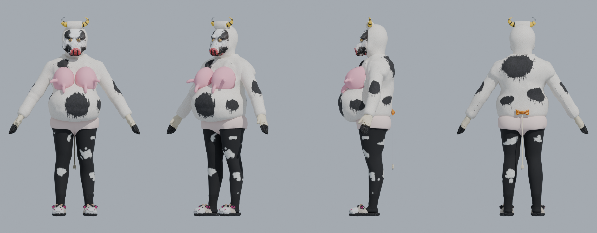

# The Misanthropic Cow for sm64coopdx

A mod that adds The Misanthropic Cow as a playable character in
[sm64coopdx](https://github.com/coop-deluxe/sm64coopdx), the PC version of Super Mario 64.
She uses her own animations where they fit (idle, walk, run, tiptoe, jump, fall,
land, skid, hurt, death, victory) and Mario's for every other action.

**This repo contains no game files.** To play, you need sm64coopdx installed with
your own copy of the game. Never add a ROM or anything extracted from one here.



## What's in this repo

| Path | What it is |
|---|---|
| `model/misanthropic_cow_game.glb` | The game-ready model: 19,970 triangles, with her rig, all 41 animations and baked textures |
| `model/misanthropic_cow_game.blend` | The same model as a Blender working file |
| `model/textures/` | The baked textures as PNGs (64–512 px) |
| `renders/` | Preview renders |
| `tools/` | The conversion scripts |

The full-quality original model (1.4 million triangles, 105 MB) is not stored here.

## Status

| Step | State |
|---|---|
| Inspect the source model (1.4M triangles, 58 bones, 41 animations) | Done |
| Reduce to about 20k triangles and bake clean textures (64–512 px) | Done |
| Rig to Mario's joint order, bones stretched to her height | Next |
| Convert her animations to the game's format | To do |
| Export the sm64coopdx mod (model + Lua) | To do |

## Tools

The scripts in `tools/` run with Blender 5.1 as a Python module (`pip install bpy==5.1.*`, plus `pillow` for turnarounds):

- `glbstats.py <file.glb>`: prints triangle counts, materials, bones and animations
  from a glTF binary without opening Blender.
- `inspect.py -- <out.blend> <file.glb>`: imports the model, prints every bone's
  position and the model's height, and saves a .blend.
- `bake.py -- <import.blend> <triangles> <out.blend> <texture folder>`: makes a reduced
  copy of every mesh within its share of the triangle budget, gives it fresh UVs and
  bakes the full-quality colours onto it. The strand fur is left out, but its colour is
  baked into the suit. The slippers are rebuilt as one shell and the briefs are welded
  first, since both are made of many loose pieces.
- `fix_layers.py -- <in.blend> <out.blend>`: pushes outer clothing (the briefs) slightly
  outward so it doesn't cut into the layers beneath.
- `turnaround.py -- <in.blend> <out.png>`: renders front, three-quarter, side and back views.
- `export_glb.py -- <in.blend> <out.glb>`: exports the model, rig and animations to a glTF binary.

Example:

```bash
python -I tools/inspect.py -- work/cow_import.blend The_Misanthropic_Cow.glb
python -I tools/bake.py -- work/cow_import.blend 20000 work/cow_low.blend work/tex
python -I tools/fix_layers.py -- work/cow_low.blend work/cow_low.blend
python -I tools/turnaround.py -- work/cow_low.blend renders/cow_low_turnaround.png
```
